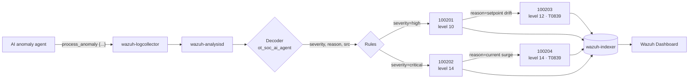
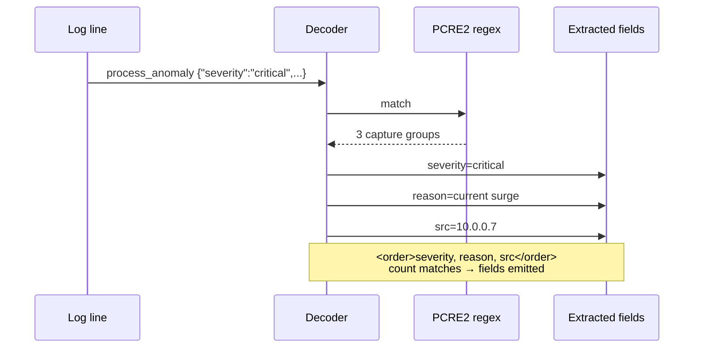
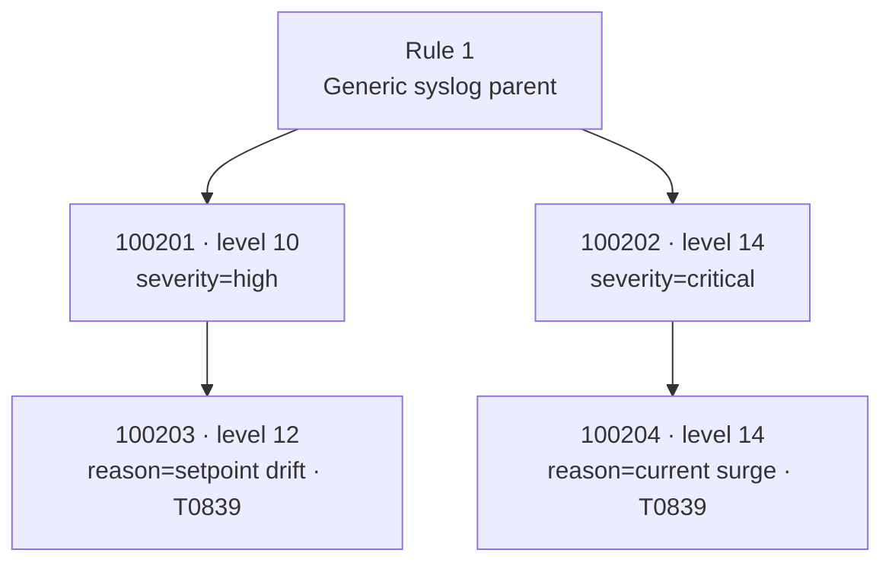

# OT SOC Refinery — Wazuh Detection Pack

Wazuh 4.14 decoders and rules for detecting AI-flagged process anomalies
in industrial control environments (OT / ICS).


---

## 1. What this repo contains

| Path | Purpose |
|------|---------|
| `wazuh/decoders/ot_soc_decoders.xml` | Decoder for `process_anomaly` log lines emitted by the OT SOC AI anomaly agent |
| `wazuh/rules/ot_soc_rules.xml` | Detection rules mapping to `severity` and `reason` fields |
| `tests/expected-results.md` | `wazuh-logtest` regression cases (3 cases, all passing) |
| `docs/diagrams/` | Pipeline, decoder-flow, and rule-tree diagrams |
| `docs/report.md` | Verification report with screenshots and findings |

---

## 2. Log format

The AI anomaly agent emits single-line events:

```
process_anomaly {"severity":"<level>","reason":"<text>","src":"<ip>"}
```

Example:

```
process_anomaly {"severity":"critical","reason":"current surge","src":"10.0.0.7"}
```

Fields are always in the order `severity → reason → src`. This order is
required by the decoder (see §4).

---

## 3. Detection pipeline



---

## 4. Decoder design — why one regex, not three

### ❌ What does NOT work (three variants tried)

| Pattern | What happens | Why |
|---------|-------------|-----|
| Three sibling child decoders | Only the **first** matching child runs; other fields silently dropped | Wazuh evaluates siblings once; first match wins |
| Three chained `<regex>` in one child | Decoder rejected silently; **no fields at all** | `<regex>` entries are alternatives, not sequential passes; `<order>` count must match capture-group count of the *winning* regex |
| `<order>json</order>` in a custom decoder | Stores the whole JSON as one literal field named `json`; does not expand keys | Custom decoders don't invoke Wazuh's built-in JSON parser |

### ✅ What DOES work

```xml
<decoder name="ot_soc_ai_agent">
  <prematch>process_anomaly</prematch>
</decoder>

<decoder name="ot_soc_ai_agent_fields">
  <parent>ot_soc_ai_agent</parent>
  <regex type="pcre2">"severity"\s*:\s*"([^"]+)".*"reason"\s*:\s*"([^"]+)".*"src"\s*:\s*"([^"]+)"</regex>
  <order>severity, reason, src</order>
</decoder>
```

**One regex, three capture groups, one `<order>` with three names, in order.**
This is the correct Wazuh pattern.



---

## 5. Rules



| Rule | Level | Parent | Fires when | MITRE |
|------|-------|--------|-----------|-------|
| 100201 | 10 | Rule 1 | `severity = high` | — |
| 100202 | 14 | Rule 1 | `severity = critical` | — |
| 100203 | 12 | 100201 | `reason = setpoint drift` | T0839 |
| 100204 | 14 | 100202 | `reason = current surge` | T0839 |

Child rules 100203 and 100204 use **exact** `<field>` matching on
`reason`. Other reasons still fire the parent but do not escalate.

---

## 6. Verification matrix

| Case | Input | Fields decoded | Rules fired | Alert | Result |
|------|-------|---------------|-------------|-------|--------|
| **A** | `severity=critical, reason=current surge, src=10.0.0.7` | severity ✅ reason ✅ src ✅ | 100202 + 100204 (level 14) | ✅ mail=True | **PASS** |
| **B** | `severity=high, reason=setpoint drift, src=10.0.0.5` | severity ✅ reason ✅ src ✅ | 100201 + 100203 (level 12) | ✅ mail=True | **PASS** |
| **C** | `severity=high, reason=unknown vibration, src=10.0.0.9` | severity ✅ reason ✅ src ✅ | 100201 only (level 10) | ✅ mail=False | **PASS** |

Case C is the **false-positive guard**: an unrecognised `reason` must
fire only the parent rule and **not** escalate to a child T0839 rule.
This is verified by its absence from Phase 3.

Full transcripts: `tests/expected-results.md`.
Verification report: `docs/report.md`.

---

## 7. MITRE ATT&CK known limitation

Rules 100203 and 100204 declare `<mitre><id>T0839</id></mitre>`
(**Pump/Valve Manipulation**, MITRE ATT&CK for ICS).

Wazuh 4.14's bundled MITRE database (`/var/ossec/var/db/mitre.db`):

- **14.7 MB**, 750 techniques, `mitre_version=2.0`
- **Zero** techniques in the `T08xx` ICS range

Therefore T0839 cannot resolve, and `wazuh-logtest` emits:

```
** Wazuh-Logtest: WARNING: Mitre Technique ID 'T0839' not found in database.
```

**This warning is cosmetic.** Alerts fire correctly with the correct
severity, description, groups, and mail flag. Only the ATT&CK annotation
field is absent from the indexed document.

### Why we keep the T0839 declaration

- T0839 is the **technically correct** ICS technique for pump/valve
  manipulation. Substituting an Enterprise technique would misrepresent
  the detection.
- The `<mitre>` block documents **intent** for anyone reading the rules.
- When the environment is upgraded to a Wazuh content bundle that
  includes ICS ATT&CK, the mapping will resolve automatically.

### How to resolve T0839 in production

1. Ingest ICS ATT&CK content into `/var/ossec/var/db/mitre.db`, **or**
2. Use a Wazuh content bundle that includes ICS techniques, **or**
3. Manually insert T0839 into the `technique` table (see `docs/report.md` §5).

---

## 8. Deploy

```bash
docker cp wazuh/decoders/ot_soc_decoders.xml \
  single-node-wazuh.manager-1:/var/ossec/etc/decoders/ot_soc_decoders.xml

docker cp wazuh/rules/ot_soc_rules.xml \
  single-node-wazuh.manager-1:/var/ossec/etc/rules/ot_soc_rules.xml

docker exec single-node-wazuh.manager-1 /var/ossec/bin/wazuh-control restart
```

Check for parse errors after restart:

```bash
docker exec single-node-wazuh.manager-1 \
  grep -iE "error|invalid" /var/ossec/logs/ossec.log | tail -20
```

Expected: no errors, `Total rules enabled: '8455'`.

---

## 9. Test

See `tests/expected-results.md` for the three regression cases.

Quick one-liner for Case A:

```bash
MSYS_NO_PATHCONV=1 docker exec -i single-node-wazuh.manager-1 \
  /var/ossec/bin/wazuh-logtest -v <<'EOF'
process_anomaly {"severity":"critical","reason":"current surge","src":"10.0.0.7"}
EOF
```

Expected Phase 2:

```
name: 'ot_soc_ai_agent'
severity: 'critical'
reason: 'current surge'
src: '10.0.0.7'
```

Expected Phase 3: rules **100202** and **100204** fire at level 14.

---

## 10. Lessons learned

1. **"Decoder matched" ≠ "fields decoded."** Always inspect Phase 2, not
   just Phase 3.
2. **Multiple `<regex>` inside one decoder are alternatives, not
   sequential passes.** `<order>` count must equal the capture-group
   count of the winning regex.
3. **Sibling child decoders run once; first match wins.** Don't rely on
   multiple children of one parent to populate multiple fields.
4. **Wazuh silently drops malformed decoders.** Check
   `/var/ossec/logs/ossec.log` for `Invalid decoder` after every change.
5. **Wazuh ships Enterprise-only MITRE content.** ICS techniques
   (T08xx) do not resolve without a custom content bundle.
6. **Test the negative case.** Case C (non-matching reason) is more
   important than Cases A and B, because it proves the pipeline won't
   over-fire.

---

## 11. License

MIT — see `LICENSE` if present, otherwise free to reuse.